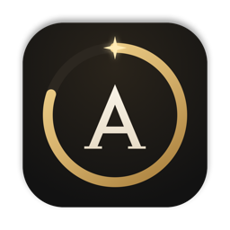
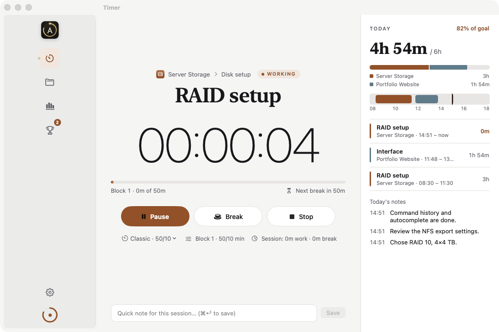
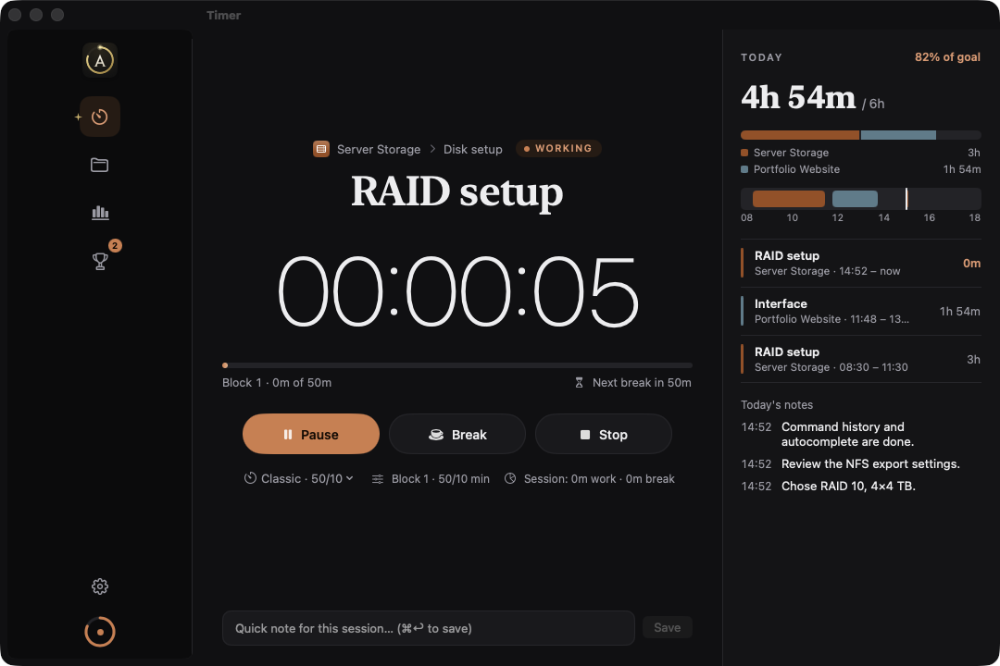
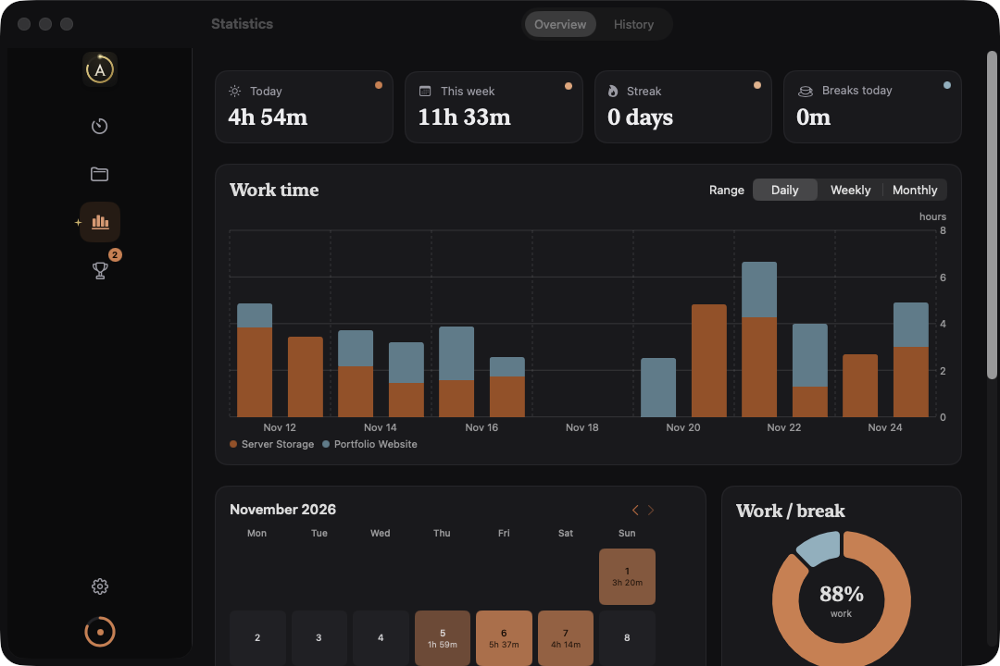
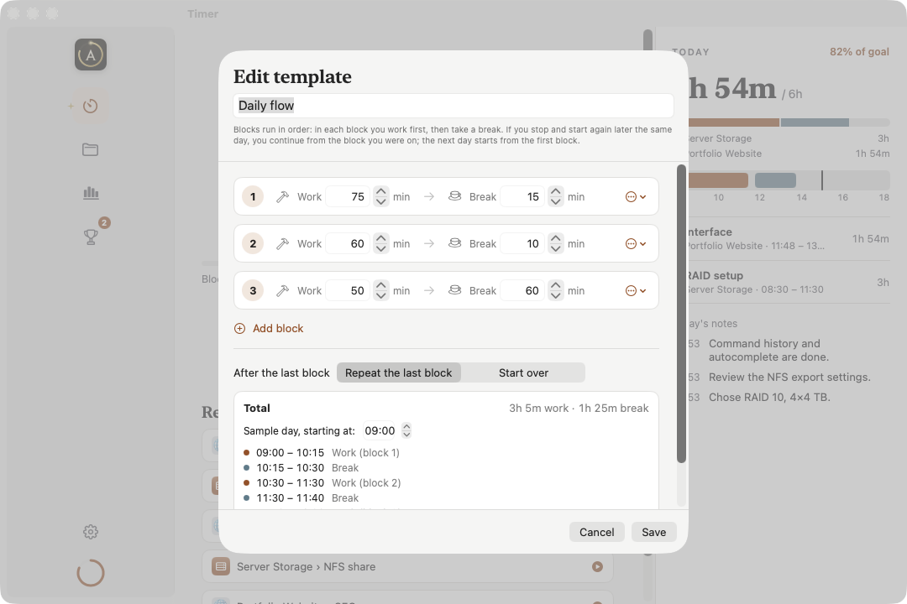
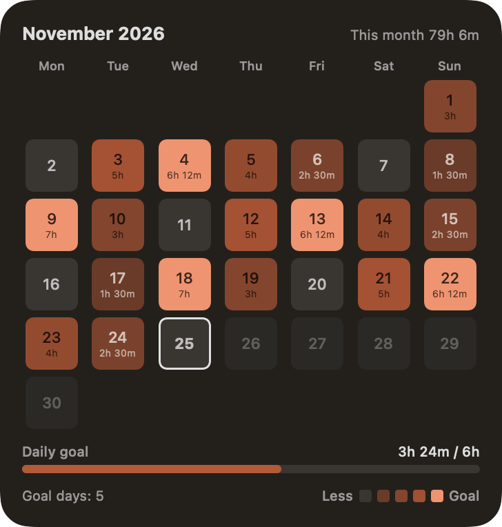
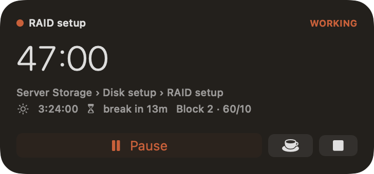

<p align="center">
  
</p>

<h1 align="center">Athlos</h1>

<p align="center">
  <b>A focused work timer for your Mac that keeps your day honest.</b><br/>
  Projects with unlimited subtopics, break plans that follow your real rhythm,<br/>
  a daily goal, a work calendar and macOS widgets. Fully offline.
</p>

<p align="center">
  
  
  
  
</p>

<p align="center">
  <a href="#download-and-install"><b>Download</b></a> ·
  <a href="docs/USER_GUIDE.md"><b>User Guide</b></a> ·
  <a href="#a-quick-tour"><b>Tour</b></a> ·
  <a href="#widgets"><b>Widgets</b></a> ·
  <a href="#features"><b>Features</b></a> ·
  <a href="#for-developers"><b>For developers</b></a>
</p>

<p align="center">
  
</p>

## Why Athlos

Most timers count minutes. Athlos keeps track of *what* you worked on and *how* your day
actually went: a long first stretch in the morning, a short break, another block, then lunch.
You build that rhythm once as a break plan, and Athlos runs it for you every day, reminds you
when it's time for a break, keeps breaks out of your work time and fills a daily goal bar as
you go.

Everything lives on your Mac. There is no account, no server and no internet connection
involved. Time is always computed from timestamps, so your hours stay correct when the Mac
sleeps, the app quits or something crashes.

The interface is in English, with Turkish one click away in **Settings → Language**.

### Light and dark

Neutral graphite surfaces with a copper accent and serif titles; the gold of the app icon stays in
the logo and its star. Choose **Light**, **Dark** or **System** in **Settings → Appearance**; the
change applies at once to the window, the menu bar popover and the desktop panel.

The **Today** panel next to the timer sums up your day at a glance: time against your goal, a bar
of work per project, a timeline from morning to evening with every work block and break, the
day's sessions (click one to continue it) and today's notes.

<p align="center">
  
  &nbsp;
  
</p>

## Download and install

1. Download **`Athlos-macOS.dmg`** from the [latest release](../../releases/latest).
2. Open the disk image and drag **Athlos** into **Applications**.
3. Open Athlos from Applications.

Athlos is not notarized by Apple yet, so the first launch is blocked by Gatekeeper. Allow it once:

- **macOS 15 (Sequoia) and later:** open Athlos, click **Done** on the warning, then go to
  **System Settings → Privacy & Security**, scroll down and click **Open Anyway** next to
  "Athlos was blocked", and confirm.
- **Or from Terminal:**
  ```bash
  xattr -dr com.apple.quarantine /Applications/Athlos.app
  ```

Requirements: macOS 15 or later on Apple Silicon. The full walkthrough is in the
[User Guide](docs/USER_GUIDE.md#1-install).

## A quick tour

### Projects and subtopics

<p align="center">
  
</p>

A project can hold as many subtopics as you like, nested as deep as you like
(Server Storage › Disk setup › RAID setup). Every row shows today's time and the total,
and totals roll up the tree automatically. Drag to reorder, right-click to rename, move or
delete. Notes can be attached to any subtopic or to a single work session.

### Break plans that follow your day

<p align="center">
  
</p>

A break plan is a list of blocks: *work 75 min → break 15 → work 60 → break 10 → work 50 →
lunch 60*. Save it as a template, or set up a **Custom plan** for today without saving
anything. Classic single-block plans (25/5, 50/10, 90/20) are included. The plan is daily:
stop at noon and start again in the afternoon, and you continue from the block you were on;
the next morning starts from the first block. You can stretch or shorten the current block on
the fly without touching the template.

### Statistics and the work calendar

<p align="center">
  
</p>

Daily, weekly and monthly charts per project, a monthly calendar where every day is colored by
how much you worked (goal days stand out in deep copper), your streak, today's breaks and the work/break
ratio. The **History** tab lists every entry: edit start and end times, delete entries, or add
time you forgot to track. Athlos warns you when a manual entry overlaps existing time, so
nothing is counted twice.

### Completed work

<p align="center">
  
  &nbsp;
  
</p>

Mark a project as completed and it moves to a gallery with its logo and total hours. You can
also add projects you finished before Athlos existed: upload the logo, enter the hours, done.

## Widgets

<p align="center">
  
  &nbsp;
  
</p>

Athlos comes with two macOS widgets for your desktop or Notification Center:

- **Work Calendar** shows this month's heatmap, today's time and your goal days
  (small, medium and large).
- **Athlos Timer** counts your session live and has **Start / Pause**, **Break** and **Stop**
  buttons that control the app directly (small and medium).

To add them: right-click the desktop → **Edit Widgets…** → search for **Athlos** → drag a
widget onto the desktop. Athlos has to be in **Applications** and opened once first.
Step-by-step instructions and troubleshooting are in the
[User Guide](docs/USER_GUIDE.md#9-macos-widgets).

There is also a **menu bar timer** with a popover, a **global shortcut** (⌃⌥Space) and an
optional in-app **desktop panel**.

## Features

**Tracking**
- **Timer:** start, pause, resume and stop; switch topics without breaking the session;
  quick notes while you work (⌘↩); a "What did you do?" note when you stop.
- **Crash-proof time:** durations come from timestamps, never from counting ticks. After a
  quit or crash Athlos asks whether to continue, end at the last activity or end now.
- **Sleep and lock:** pause automatically when the Mac sleeps or the screen locks, or keep
  counting; your choice.
- **Idle detection (optional):** after X minutes without keyboard or mouse input Athlos asks
  whether to keep or discard the idle time.

**Breaks and goals**
- **Break plans:** templates made of work/break blocks, a custom plan without a template,
  "repeat the last block" or "start over" after the last block.
- **Break flow:** notifications when a break starts and ends, automatic break countdown,
  skip or snooze (5 min by default), manual breaks. Breaks are recorded but never counted as
  work.
- **Daily goal:** 6 hours by default, adjustable. A live bar that turns deep copper past the goal and
  a small celebration when you reach it.

**Organizing and history**
- **Projects:** icon (SF Symbol, emoji or your own logo), color, unlimited nested subtopics,
  drag-and-drop ordering, move, rename, delete with confirmation (entries move to the parent).
- **Statistics:** stacked charts per project, monthly calendar, streak, work/break ratio,
  per-topic totals for today and all time.
- **History:** edit, delete and add entries; overlap warnings.
- **Completed projects:** gallery with logos and hours, add past projects with their time.

**Your Mac, your data**
- **Fully offline:** no account, no server, no analytics.
- **Backups:** export and import everything as JSON (logos included); a daily automatic
  backup, keeping the last 7.
- **Everywhere on macOS:** main window, menu bar, global shortcut, macOS widgets, desktop
  panel.
- **Languages:** English and Turkish.
- **Appearance:** light and dark themes (graphite + copper), or follow the system.
- **Today panel:** time vs. goal, work per project, a day timeline, sessions and notes.

## Your data

All data is stored in `~/Library/Application Support/Athlos/`:

| File / folder | What it is |
|---|---|
| `data.json` | Projects, topics, time entries, notes, settings |
| `Images/` | Project logos you uploaded |
| `Backups/` | Daily automatic backups (last 7) |
| `widget-snapshot.json` | A small summary the widgets read |

Nothing leaves your Mac. To move to another Mac, use **Settings → Backup → Export as JSON…**
and import the file there.

## For developers

Athlos is a native Swift 6 / SwiftUI app with no third-party dependencies.

**Requirements:** Xcode 16 or later, [XcodeGen](https://github.com/yonaskolb/XcodeGen)
(`brew install xcodegen`).

```bash
make app       # generate the Xcode project and build build/Athlos.app (with widgets)
make run       # build and open
make test      # unit tests (swift-testing)
make install   # copy to /Applications
```

`scripts/package_release.sh` builds the app and creates `Athlos-macOS.dmg` and
`Athlos-macOS.zip` in `build/release/`.

Without Xcode (Command Line Tools only) `make app` still builds the app through SwiftPM, but
without the widgets: widget extensions need Xcode for App Intents metadata.

**Layout**

| Path | Contents |
|---|---|
| `Sources/AthlosCore/` | Models, the JSON store, the timer and break-plan logic, statistics, backups, widget snapshot. No UI, fully tested. |
| `Sources/Athlos/` | The SwiftUI app: windows, menu bar, settings, notifications, global shortcut, desktop panel, widget bridge. |
| `Widgets/` | The WidgetKit extension: Work Calendar and Athlos Timer, App Intents for the buttons. |
| `Resources/` | `Info.plist`, `Localizable.xcstrings` (English + Turkish), app icon. |
| `Tests/AthlosCoreTests/` | Unit tests: durations, plans, sleep/recovery, trees, statistics, backups, widget bridge. |
| `project.yml` | XcodeGen project (app, widget extension, core framework, tests). |

Demo data for screenshots: `ATHLOS_DEMO=1 ATHLOS_DATA_DIR=/tmp/athlos-demo build/Athlos.app/Contents/MacOS/Athlos`.
