<p align="center">
  
</p>

<h1 align="center">Athlos</h1>

<p align="center">
  <b>A work timer for your Mac that shows you where your day actually went.</b><br/>
  Projects with unlimited subtopics, break plans that follow your real rhythm,<br/>
  a daily goal, a Today panel, a work calendar and macOS widgets. Fully offline.
</p>

<p align="center">
  
  
  
  
</p>

<p align="center">
  <a href="#download-and-install"><b>Download</b></a> ·
  <a href="docs/USER_GUIDE.md"><b>User Guide</b></a> ·
  <a href="#a-quick-tour"><b>Tour</b></a> ·
  <a href="#light-and-dark"><b>Light and dark</b></a> ·
  <a href="#features"><b>Features</b></a> ·
  <a href="#for-developers"><b>For developers</b></a>
</p>

<p align="center">
  
</p>

## Why I built Athlos

On a normal day I switch between several projects, each with its own pile of smaller tasks.
At six in the evening I could tell you I had been busy, but not *on what*: how long the storage
work really took, whether I ever took the breaks I meant to take, or how close I came to a
real day's work.

The timers I tried either counted minutes without knowing what they belonged to, or wanted an
account, a subscription and a server somewhere. I wanted something else: a small, native Mac
app that keeps my projects as a tree (project › topic › subtopic, as deep as I like), runs the
break rhythm I actually follow (a long first block, a short break, another block, then lunch),
and at a glance tells me how today is going. Everything stays on my Mac, and the hours stay
correct even when the laptop sleeps, the app quits or something crashes.

*Athlos* (ἆθλος) is the Greek word for a labour or a contest, the word used for the twelve
labours of Heracles. A working day is a series of them; Athlos keeps count.

The interface is in English, with Turkish one click away in **Settings → Language**.

## A quick tour

### The timer and your day

The topic you are working on sits in the middle, in a serif title over a large clock. Under it,
a thin line shows how far you are into the current work block and when the next break comes.
**Space** starts and pauses, **⌘K** jumps to any topic, and a quick note (⌘↩) is always one
keystroke away.

The **Today** panel next to the clock sums up the day: time against your goal, a bar of work
per project, a timeline from morning to evening with every work block and break and a line at
the current time, the day's sessions (click one to continue it) and today's notes.

### Projects and subtopics

<p align="center">
  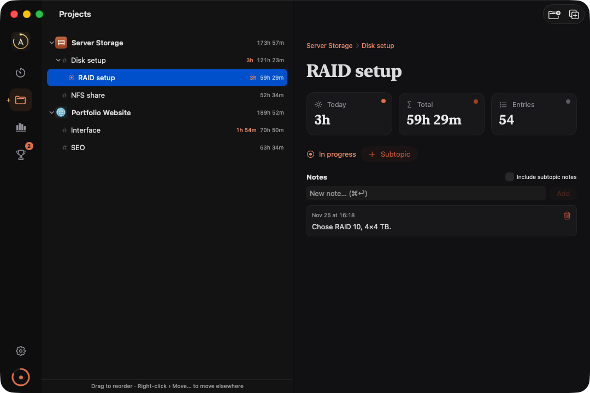
</p>

A project can hold as many subtopics as you like, nested as deep as you like
(Server Storage › Disk setup › RAID setup). Every row shows today's time and the total, and
totals roll up the tree automatically. Drag to reorder, right-click to rename, move or delete.
Notes can be attached to any subtopic or to a single work session.

### Break plans that follow your day

<p align="center">
  
</p>

A break plan is a list of blocks: *work 75 min → break 15 → work 60 → break 10 → work 50 →
lunch 60*. Save it as a template, or set up a **Custom plan** for today without saving
anything. Classic single-block plans (25/5, 50/10, 90/20) are included. The plan is daily:
stop at noon and start again in the afternoon, and you continue from the block you were on;
the next morning starts from the first block. You can stretch or shorten the current block on
the fly without touching the template.

### Statistics and the work calendar

<p align="center">
  
  &nbsp;
  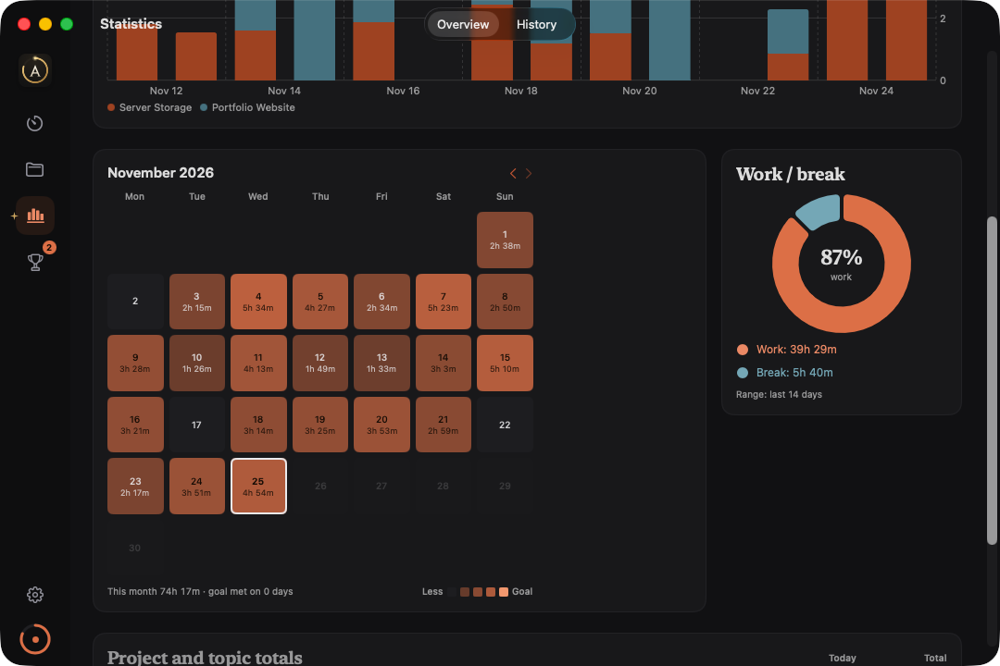
</p>

Daily, weekly and monthly charts per project, a monthly calendar where every day is shaded by
how much you worked (goal days stand out), your streak, today's breaks and the work/break
ratio. The **History** tab lists every entry: edit start and end times, delete entries, or add
time you forgot to track. Athlos warns you when a manual entry overlaps existing time, so
nothing is counted twice.

### Completed work

<p align="center">
  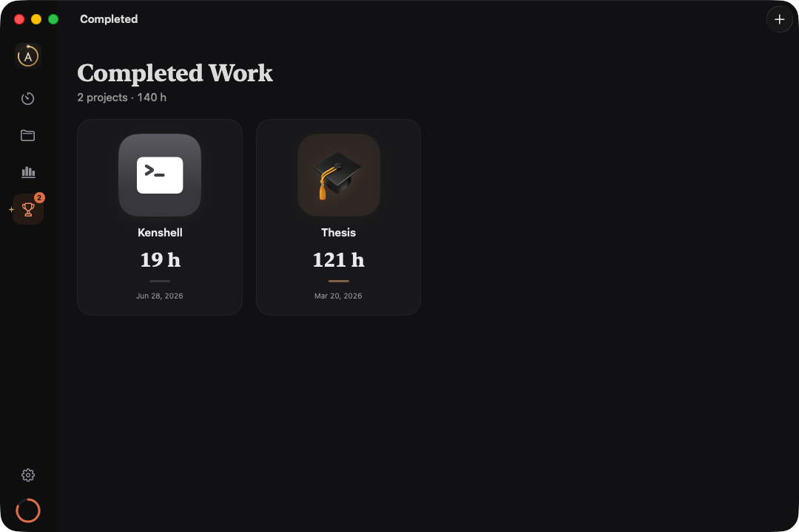
  &nbsp;
  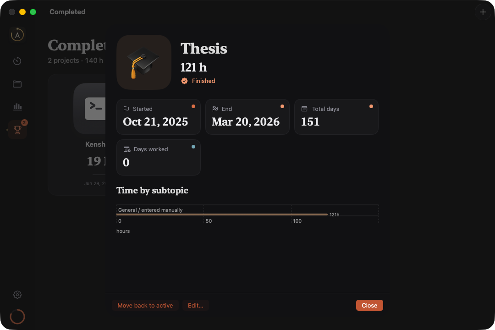
</p>

Mark a project as completed and it moves to a gallery with its logo and total hours. You can
also add projects you finished before Athlos existed: upload the logo, enter the hours, done.

### Widgets, menu bar and desktop panel

<p align="center">
  
  &nbsp;
  
</p>

Two macOS widgets for your desktop or Notification Center: **Work Calendar** (this month's
heatmap, today's time, goal days) and **Athlos Timer** (a live session with **Start / Pause**,
**Break** and **Stop** buttons that control the app). To add them: right-click the desktop →
**Edit Widgets…** → search for **Athlos**. Athlos has to be in **Applications** and opened once
first; details are in the [User Guide](docs/USER_GUIDE.md#9-macos-widgets).

There is also a **menu bar timer** with a popover, a **global shortcut** (⌃⌥Space) and an
optional in-app **desktop panel** that sits behind your windows.

<p align="center">
  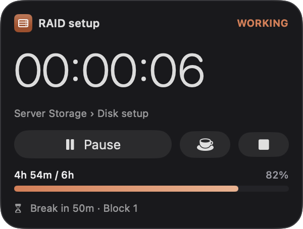
</p>

## Light and dark

Athlos has a dark and a light theme: graphite surfaces, a copper accent, steel blue for breaks
and serif titles. The gold of the icon stays in the logo and its small star, which also marks
the current page in the icon rail. Choose **Settings → Appearance → System / Light / Dark**;
the change applies at once to the window, the menu bar popover and the desktop panel. The
screenshots above are in the dark theme; here is every main screen in both.

| Light | Dark |
|:---:|:---:|
| 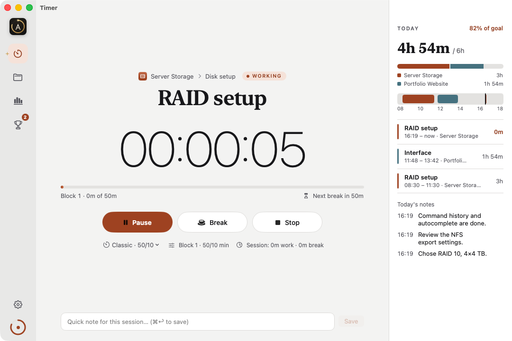 |  |
| 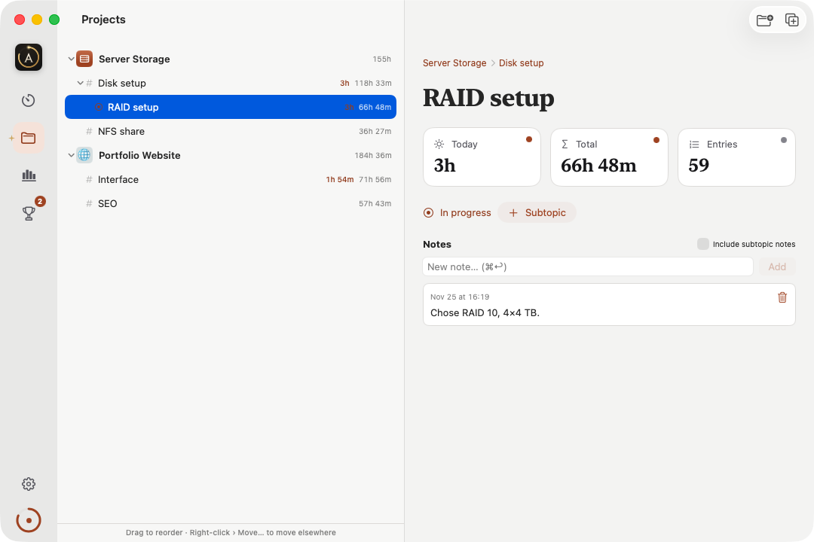 |  |
| 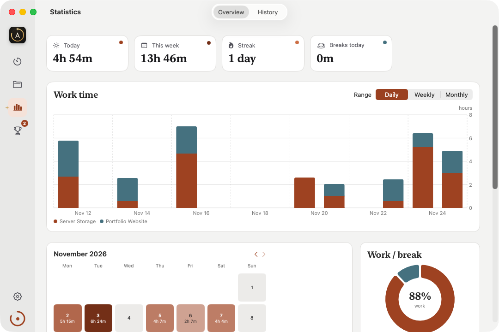 |  |
| 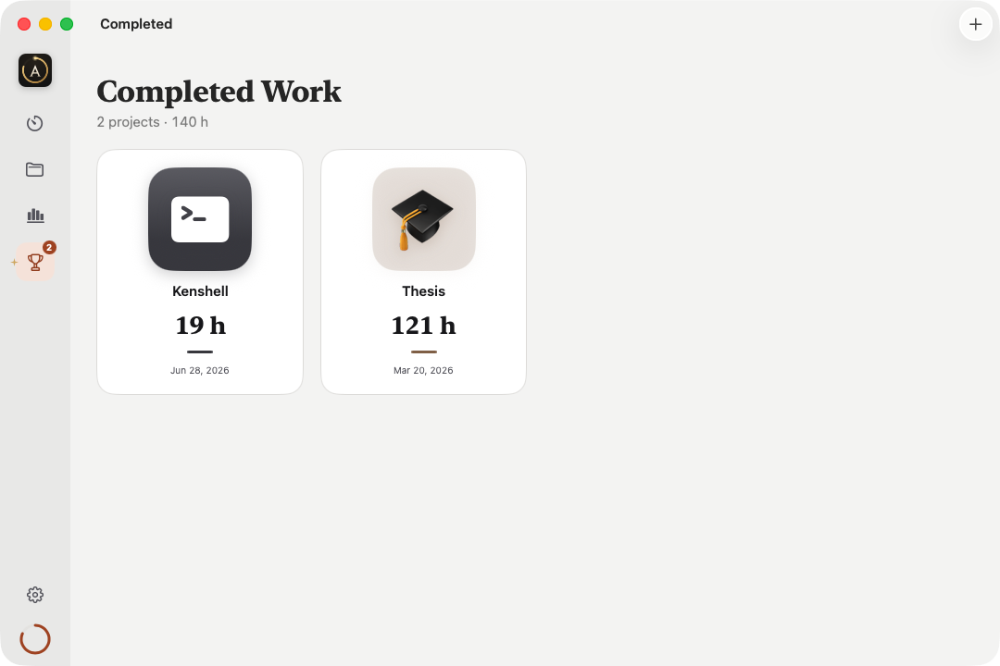 |  |
| 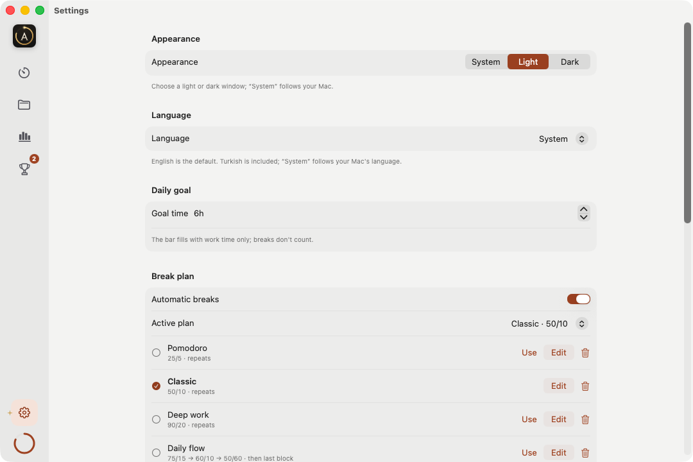 | 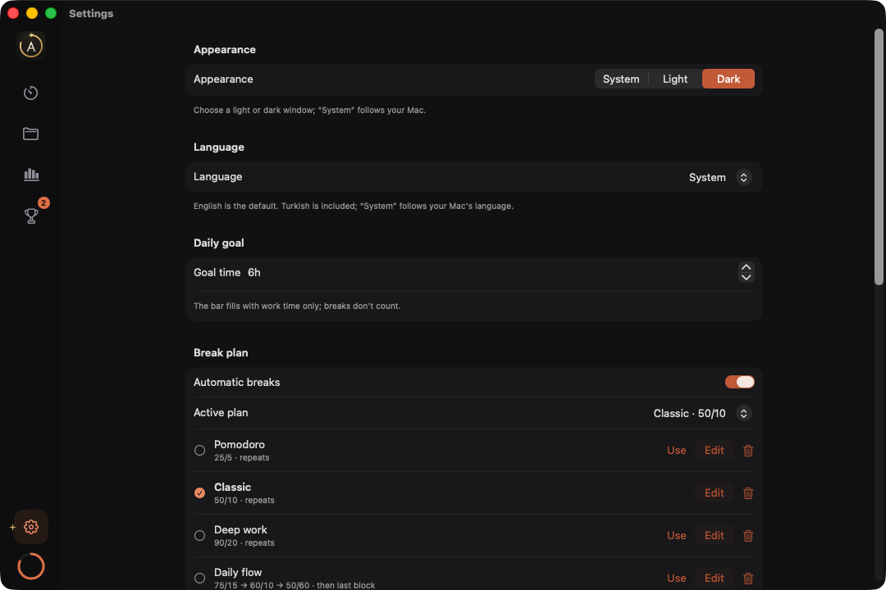 |

## Features

**Tracking**
- **Timer:** start, pause, resume and stop; switch topics without breaking the session;
  quick notes while you work (⌘↩); a "What did you do?" note when you stop.
- **Today panel:** time against your goal, work per project, a day timeline with blocks and
  breaks, the day's sessions (click to continue one) and today's notes.
- **Crash-proof time:** durations come from timestamps, never from counting ticks. After a
  quit or crash Athlos asks whether to continue, end at the last activity or end now.
- **Sleep and lock:** pause automatically when the Mac sleeps or the screen locks, or keep
  counting; your choice.
- **Idle detection (optional):** after X minutes without keyboard or mouse input Athlos asks
  whether to keep or discard the idle time.

**Breaks and goals**
- **Break plans:** templates made of work/break blocks, a custom plan without a template,
  "repeat the last block" or "start over" after the last block; adjust the current block on
  the fly.
- **Break flow:** notifications when a break starts and ends, an automatic break countdown,
  skip or snooze (5 min by default), manual breaks. Breaks are recorded but never counted as
  work.
- **Daily goal:** 6 hours by default, adjustable. A live bar and a ring in the icon rail, and
  a small celebration when you reach it.

**Organizing and history**
- **Projects:** icon (SF Symbol, emoji or your own logo), color, unlimited nested subtopics,
  drag-and-drop ordering, move, rename, delete with confirmation (entries move to the parent).
- **Statistics:** stacked charts per project, a monthly calendar, streak, work/break ratio,
  per-topic totals for today and all time.
- **History:** edit, delete and add entries; overlap warnings.
- **Completed projects:** a gallery with logos and hours; add past projects with their time.

**Everywhere on your Mac**
- **Main window** with a narrow icon rail, a **menu bar timer**, a **global shortcut**
  (⌃⌥Space), two **macOS widgets** and a **desktop panel**.
- **Keyboard first:** Space, ⌘K, ⇧⌘E, ⇧⌘B, ⌘N, ⌘1–5 and more (see the
  [User Guide](docs/USER_GUIDE.md#17-keyboard-shortcuts)).

**App**
- **Interface:** dark, light or system theme; English (default) and Turkish.
- **Backups:** export and import everything as JSON (logos included); a daily automatic
  backup, keeping the last 7.
- **Privacy:** fully offline. No account, no server, no analytics.

## Performance

A timer runs all day, so it has to be light. Measured on an Apple silicon Mac with the release
build and the demo data:

| Measure | Result |
| --- | --- |
| Launch to window (median of 5) | 1.3 s |
| Memory, timer running | ~120 MB |
| CPU, idle | ~1 % |
| CPU, timer running (window open, clock ticking) | ~2 % |
| App size | 7.7 MB |
| Installer (dmg) | 2.9 MB |

## Download and install

<p align="center">
  <a href="../../releases/latest/download/Athlos-macOS.dmg"></a>
</p>

Click the button: the download starts directly, always the newest version.

| Package | Download | Notes |
| --- | --- | --- |
| **Disk image** (recommended) | [Athlos-macOS.dmg](../../releases/latest/download/Athlos-macOS.dmg) | Open it and drag Athlos into Applications. |
| **Zip** | [Athlos-macOS.zip](../../releases/latest/download/Athlos-macOS.zip) | Unzip and move Athlos.app into Applications. |

Requirements: macOS 15 or later on Apple silicon. Release notes and older versions:
[Releases](../../releases).

### First launch

Athlos is not notarized by Apple yet, so macOS warns you the first time:

- **macOS 15 (Sequoia) and later:** open Athlos, click **Done** on the warning, then open
  **System Settings → Privacy & Security**, scroll down and click **Open Anyway** next to
  "Athlos was blocked", and confirm. This is needed only once.
- **Or from Terminal:**
  ```bash
  xattr -dr com.apple.quarantine /Applications/Athlos.app
  ```

The full walkthrough, including the widgets, is in the [User Guide](docs/USER_GUIDE.md#1-install).

## Documentation

- **[User Guide](docs/USER_GUIDE.md):** every feature step by step, keyboard shortcuts and
  troubleshooting.

## Privacy

- **Nothing leaves your Mac:** no account, no server, no telemetry, no analytics.
- **Your data in one place:** everything is stored in `~/Library/Application Support/Athlos/`.

| File / folder | What it is |
|---|---|
| `data.json` | Projects, topics, time entries, notes, settings |
| `Images/` | Project logos you uploaded |
| `Backups/` | Daily automatic backups (last 7) |
| `widget-snapshot.json` | A small summary the widgets read |

To move to another Mac, use **Settings → Backup → Export as JSON…** and import the file there.

---

## For developers

<p>
  
  
  
  
</p>

### Building from source

**Requirements:** Xcode 16 or later and [XcodeGen](https://github.com/yonaskolb/XcodeGen)
(`brew install xcodegen`).

```bash
make app       # generate the Xcode project and build build/Athlos.app (with widgets)
make run       # build and open
make test      # unit tests (swift-testing)
make release   # build/release/Athlos-macOS.dmg + .zip + SHA256SUMS.txt
```

Without Xcode (Command Line Tools only) `make app` still builds the app through SwiftPM, but
without the widgets: widget extensions need Xcode for App Intents metadata.

#### Checks and tools

| Task | Command |
| --- | --- |
| Unit tests (39 tests, 7 suites) | `make test` |
| Release build with widgets | `make app` |
| Installer packages | `make release` |
| Xcode project (not in git) | `xcodegen generate` |
| App icon | `scripts/make_icon.sh` |
| Demo data | `ATHLOS_DEMO=1 ATHLOS_DATA_DIR=/tmp/athlos-demo build/Athlos.app/Contents/MacOS/Athlos` |
| Demo in Turkish | the same with `-AppleLanguages "(tr)"` |

With `ATHLOS_DEMO=1` the demo also accepts `ATHLOS_DEMO_ROUTE` (`timer`, `projects`, `stats`,
`showcase`, `settings`), `ATHLOS_DEMO_APPEARANCE` (`light`, `dark`) and `ATHLOS_DEMO_START=1`,
which is how the screenshots in this README are made.

### Architecture

Athlos is a native SwiftUI app. All logic that can be tested lives in **AthlosCore**, a
framework with no UI; the app and the widget extension only draw it and pass commands in.

```
┌──────────────── Athlos.app (SwiftUI) ───────────────────────────────────────┐
│  Views/        icon rail, Timer + Today panel, Projects, Statistics,         │
│                Completed, Settings, menu bar popover, desktop panel          │
│  Theme         every color (light/dark), serif type, cards, the logo         │
│  AppModel      @Observable view model, one tick per second, UI state         │
│  Services/     notifications, global shortcut, sleep/lock/idle, widget bridge│
└───────────────▲─────────────────────────────────────────┬────────────────────┘
                │ reads                                    │ calls
┌───────────────┴─────────────────────────────────────────▼────────────────────┐
│  AthlosCore (framework, no UI, fully tested)                                 │
│  AppStore      the single source of truth; every change saved to data.json  │
│  TimerService  sessions, pauses, breaks, daily break plans, recovery        │
│  Stats         totals, daily calendar, streaks, DaySummary (Today panel)    │
│  Backup · Persistence · WidgetSnapshot (snapshot file + command folder)     │
└───────────────▲──────────────────────────────────────────────────────────────┘
                │ snapshot file + command folder, Darwin notification
┌───────────────┴──────────────────────────────────────────────────────────────┐
│  AthlosWidgets (WidgetKit): Work Calendar, Athlos Timer, App Intents buttons │
└──────────────────────────────────────────────────────────────────────────────┘
```

#### Repository layout

| Path | What is there |
| --- | --- |
| `Sources/AthlosCore/` | Models, the JSON store, timer and break-plan logic, statistics, backups, widget snapshot |
| `Sources/Athlos/App/` | App entry, menu commands, `AppModel`, language choice, demo data |
| `Sources/Athlos/Views/` | Every screen; `Components/Theme.swift` holds the design tokens, `AthlosLogo.swift` draws the logo |
| `Sources/Athlos/Services/` | Notifications, global shortcut, sleep/idle monitor, desktop panel, widget bridge |
| `Widgets/` | The WidgetKit extension and its App Intents |
| `Resources/` | `Info.plist`, `Localizable.xcstrings` (English + Turkish), app icon |
| `Tests/AthlosCoreTests/` | Durations, plans, sleep and recovery, trees, statistics, the day summary, backups, widget bridge |
| `scripts/` | Build, test, release packaging and icon rendering |
| `docs/` | User guide and README assets |
| `project.yml` | XcodeGen project (app, widget extension, core framework, tests) |

#### Design rules

- **Time comes from timestamps, never from counting ticks.** A sleeping Mac or a crash can't
  change your hours.
- **One store.** Every change goes through `AppStore` and is written to disk at once.
- **Old data always opens.** New fields are decoded with `decodeIfPresent`; a test opens data
  written by earlier versions.
- **Colors only from `Theme`.** No system colors in views; every token has a light and a dark
  value.
- **English in code, Turkish in the String Catalog.** Placeholders keep the same order in both
  languages.
- **No third-party dependencies.** Only Apple frameworks.

## License

Copyright © 2026 omereniskorkusuz. All rights reserved.

The source code is published so you can read it and see how Athlos works. No licence is
granted: you may not copy, modify, redistribute or reuse it, in whole or in part, without my
written permission. You are welcome to download and use the released app. Bug reports and
ideas are welcome as issues; changes to the code are made only by me.

Apple, macOS, SwiftUI and WidgetKit are trademarks of Apple Inc.; Athlos is not affiliated
with or endorsed by Apple.
