# Athlos User Guide

Athlos is a work timer for macOS. You organize your work into projects and subtopics, run a
timer on the one you're working on, and Athlos takes care of breaks, your daily goal,
statistics and widgets. Everything stays on your Mac.

**Contents**

1. [Install](#1-install)
2. [First launch](#2-first-launch)
3. [Projects and subtopics](#3-projects-and-subtopics)
4. [The timer](#4-the-timer)
5. [Break plans](#5-break-plans)
6. [Daily goal](#6-daily-goal)
7. [Menu bar and global shortcut](#7-menu-bar-and-global-shortcut)
8. [Desktop panel](#8-desktop-panel)
9. [macOS widgets](#9-macos-widgets)
10. [Statistics and the work calendar](#10-statistics-and-the-work-calendar)
11. [History and manual entries](#11-history-and-manual-entries)
12. [Completed projects](#12-completed-projects)
13. [Sleep, lock and idle time](#13-sleep-lock-and-idle-time)
14. [Unfinished sessions](#14-unfinished-sessions)
15. [Backup, export and import](#15-backup-export-and-import)
16. [Language](#16-language)
17. [Keyboard shortcuts](#17-keyboard-shortcuts)
18. [Where your data lives](#18-where-your-data-lives)
19. [Troubleshooting](#19-troubleshooting)
20. [Uninstall](#20-uninstall)

---

## 1. Install

**Requirements:** macOS 15 (Sequoia) or later, a Mac with Apple Silicon.

1. Download **`Athlos-macOS.dmg`** from the project's **Releases** page.
2. Open the disk image and drag **Athlos** onto the **Applications** folder.
3. Eject the disk image and open **Athlos** from Applications (or Spotlight: ⌘Space, "Athlos").

### "Athlos can't be opened" / "Apple could not verify…"

Athlos isn't notarized by Apple yet, so macOS blocks it the first time. You only need to allow
it once:

1. Open Athlos. When the warning appears, click **Done** (not "Move to Trash").
2. Open **System Settings → Privacy & Security**.
3. Scroll down to the message *"Athlos" was blocked…* and click **Open Anyway**.
4. Confirm with **Open Anyway** again and enter your password if asked.

Prefer Terminal? This does the same in one line:

```bash
xattr -dr com.apple.quarantine /Applications/Athlos.app
```

> Keep Athlos in **Applications**. The macOS widgets only work from there.

## 2. First launch

The first time you open Athlos you see a welcome screen. Click **Create your first project**,
give it a name and an icon, and you're ready.

The window has five pages in the sidebar:

| Page | What it's for |
|---|---|
| **Timer** | The big clock, the active topic, start/pause/stop, breaks, quick notes, daily goal |
| **Projects** | Your project tree, topic details and notes |
| **Statistics** | Charts, the monthly work calendar and the history of all entries |
| **Completed** | A gallery of the projects you finished |
| **Settings** | Language, daily goal, break plans, idle/sleep, shortcuts, backups |

Athlos also lives in the **menu bar**. Closing the window doesn't quit it; your timer keeps
running. To quit, use **Athlos → Quit Athlos** (⌘Q) or **Quit** in the menu bar popover.

## 3. Projects and subtopics

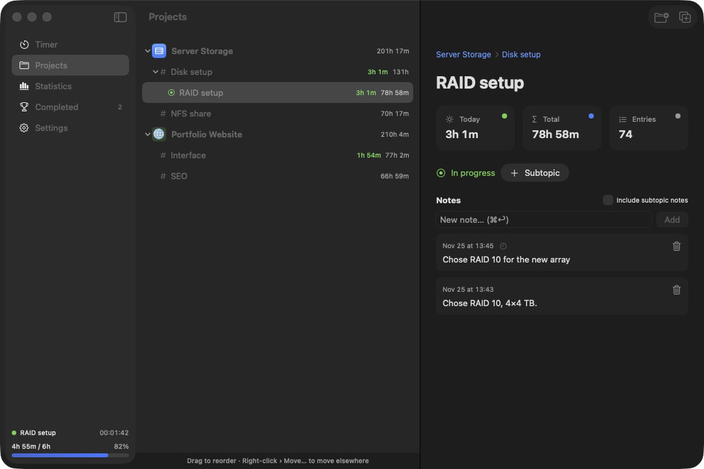

- **New project:** ⌘N, or the folder button in the toolbar. Choose an icon (SF Symbol, emoji
  or your own logo), a color and a name.
- **New subtopic:** select a project or subtopic and press ⇧⌘N, or use **Subtopic** in the
  detail pane. Subtopics can be nested as deep as you like.
- **Reorder:** drag rows within the same level.
- **Move somewhere else:** right-click → **Move…** and pick the new parent (it can be in
  another project; its time moves with it). **Move up one level** takes a subtopic out of its
  parent.
- **Rename / delete:** right-click → **Rename…** or **Delete…**. Deleting a subtopic never
  deletes time: its entries and notes move to the parent topic.
- **Totals:** every row shows today's time (green) and the total. A parent's total includes
  all its subtopics.
- **Notes:** in the detail pane, type a note and press ⌘↩. Turn on **Include subtopic notes**
  to see the notes of everything underneath.
- **Start from here:** click **Start** on a project or subtopic to start the timer on it.

## 4. The timer

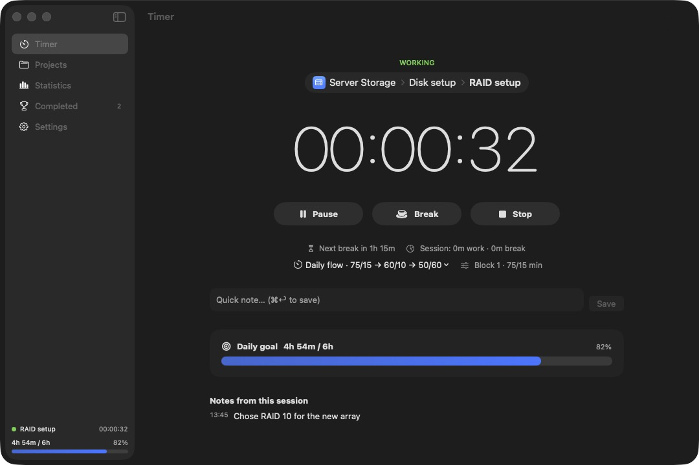

- **Start:** click **Start** (or press Space on the Timer page). If no topic is selected, a
  searchable picker opens; type a few letters of any part of the path ("ser raid") and press
  ↩. **Recent** topics on the Timer page start with one click.
- **Pause / Resume:** Space, the **Pause** button, the menu bar, a widget or ⌃⌥Space anywhere.
- **Switch topic:** click the path above the clock (or ⌘K) while a session is running. Time so
  far stays on the previous topic; the session goes on.
- **Quick note:** type in the note field and press ⌘↩. The note is linked to the topic and to
  the current session.
- **Stop:** **Stop** (⇧⌘E). Athlos asks *What did you do?*: write a short note, or stop without
  one. You can turn this question off in Settings.

Your time is never counted by ticking. Athlos stores when each work period started and ended
and computes everything from those timestamps.

## 5. Break plans

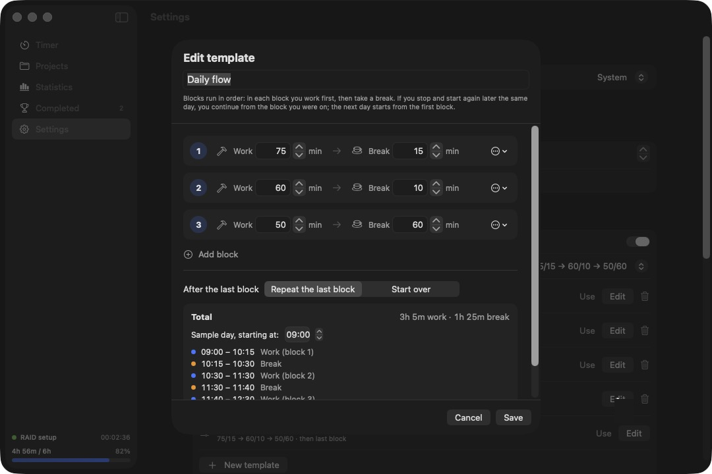

A break plan is a list of **blocks**. Each block is a work period followed by a break:

| Block | Work | Break |
|---|---|---|
| 1 | 75 min | 15 min |
| 2 | 60 min | 10 min |
| 3 | 50 min | 60 min (lunch) |

When a block's work time is reached, the break starts automatically and you get a
notification. When the break ends you get a *Ready to continue?* notification and the timer
waits for you. The next block starts when you continue.

**Choosing a plan:** on the Timer page click the plan name under the buttons
(e.g. *Daily flow · 75/15 → 60/10 → 50/60*), or use **Settings → Break plan → Use**.

**Templates:** Pomodoro (25/5), Classic (50/10), Deep work (90/20) and Daily flow are
included. **Edit** a template or create a **New template**. In the editor:

- type minutes directly or use the arrows (5-minute steps);
- **Add block**, and use the ⋯ menu of a block to move it up, down or delete it;
- **After the last block:** *Repeat the last block* or *Start over*;
- the **Sample day** shows the timeline for a start time you choose.

**Custom plan (no template):** when you just want to set today's rhythm without saving a
template, use **Set up custom plan…** in the plan menu. **Save as template…** turns it into a
template later if you like it.

**The plan follows your day.** If you stop at noon and start again at 14:00, you continue from
the block you were on (time in between doesn't count). The next day starts from block 1. Use
**Restart plan from first block** in the plan menu to start over manually.

**Change the current block only:** click **Block 2 · 60/10 min** next to the plan name. You can
set this block's work and break minutes, start the break now, or skip the block. The template
doesn't change.

**During a break:** **End break** (back to work), **Skip** (skip this break, next block starts
now) or **Snooze 5 min** (work 5 more minutes; the snooze length is in Settings).

Breaks are recorded separately and are never counted as work. Turn automatic breaks off with
**Breaks on** in the plan menu or in Settings.

## 6. Daily goal

The goal bar fills second by second with **work** time only (breaks don't count). The default
goal is 6 hours; change it in **Settings → Daily goal**. When you reach it, the bar turns gold
and a small celebration plays. Past the goal, Athlos shows how far over you are.

## 7. Menu bar and global shortcut

- The menu bar shows the running time (▶ 01:23:45), the break countdown (☕ 07:12) or just an
  icon when idle. Click it for a popover with the active topic, Start/Pause/Break/Stop, the goal
  bar and your five most recent topics.
- **⌃⌥Space** starts or pauses the timer from any app. If nothing is running, it starts your
  most recent topic. You can turn it off in **Settings → Shortcuts and notifications**.

## 8. Desktop panel

Besides the macOS widgets, Athlos has its own small panel that sits on your desktop behind your
windows. Turn it on with **View → Desktop Widget** (⌥⌘W), the switch in the menu bar popover,
or **Settings → Desktop widget**. Drag it by its title; right-click it for size (small, medium,
large with calendar) and **Hide widget**.

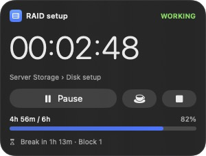

## 9. macOS widgets

Athlos has two real macOS widgets that you can put on the desktop or in Notification Center.

| Widget | Sizes | What it shows |
|---|---|---|
| **Work Calendar** | small, medium, large | This month's heatmap, today's time, monthly total, goal days, goal bar |
| **Athlos Timer** | small, medium | The live session time, the active topic, **Start/Pause**, **Break**, **Stop** |

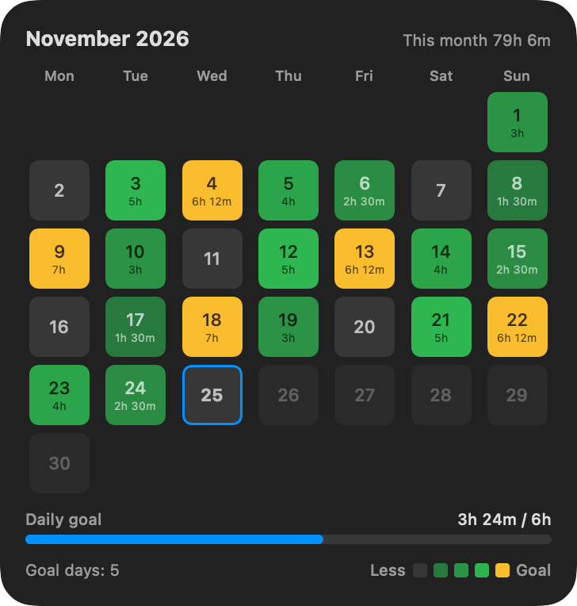 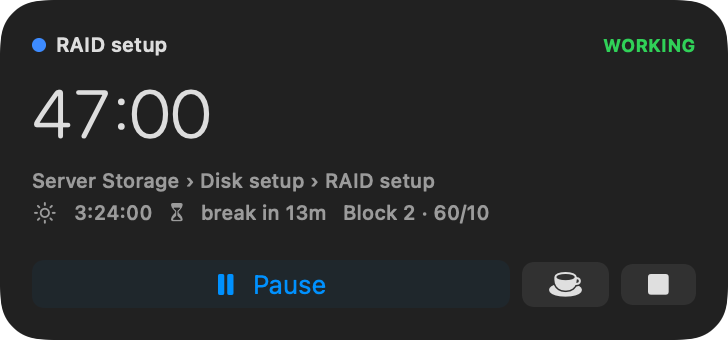

### Add a widget

1. Make sure **Athlos is in Applications** and that you've **opened it at least once**.
2. Right-click an empty spot on the desktop and choose **Edit Widgets…**
   (or open Notification Center by clicking the date in the menu bar and choose
   **Edit Widgets** at the bottom).
3. Type **Athlos** in the search field at the top left.
4. Choose a size, then drag **Work Calendar** or **Athlos Timer** onto the desktop
   (or click it to add it to Notification Center).
5. Click **Done**.

### Using the widgets

- The timer counts live by itself. **Start/Pause**, **Break** and **Stop** act immediately;
  Athlos doesn't come to the front. (Stopping from the widget doesn't ask for a note.)
- Clicking the Work Calendar opens the Statistics page.
- The buttons need Athlos to be running. It can run in the background: closing the window is
  fine, quitting it is not. A command sent while Athlos is closed is applied if you open
  Athlos within two minutes.
- Widgets follow your Mac's system language (English or Turkish).

### Widgets don't appear in the gallery

1. Check that Athlos is in `/Applications` (not in Downloads or on the disk image).
2. Open Athlos once, quit it (⌘Q) and open it again.
3. If you installed with the Gatekeeper warning still active, remove the quarantine flag and
   open Athlos again:
   ```bash
   xattr -dr com.apple.quarantine /Applications/Athlos.app
   ```
4. Still nothing? Log out and back in (this restarts the widget service).

### A widget shows "Open Athlos once to see your data"

The widget hasn't received any data yet. Open Athlos; widgets update within a few seconds.

## 10. Statistics and the work calendar

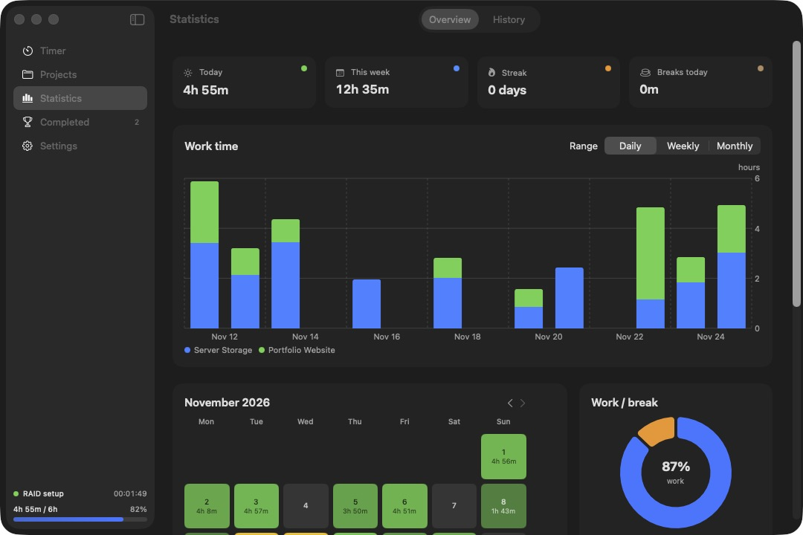

- **Tiles:** today, this week, your streak (days in a row you met the goal) and today's breaks.
- **Work time chart:** stacked bars per project, **Daily** (14 days), **Weekly** (12 weeks) or
  **Monthly** (12 months).
- **Monthly calendar:** each day is colored by how much you worked; gold days met the goal;
  today has a blue outline. Use ‹ › to change months. Click a day to see the time per project.
- **Work / break:** the ratio for the selected range.
- **Project and topic totals:** today and all time, for every project and subtopic.

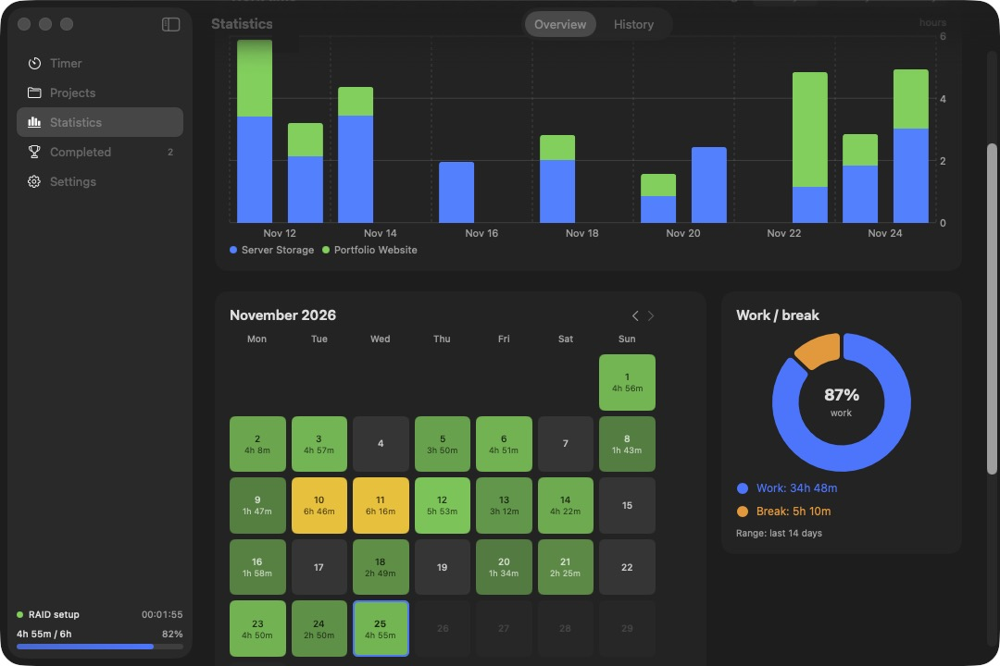

## 11. History and manual entries

Open **Statistics → History**.

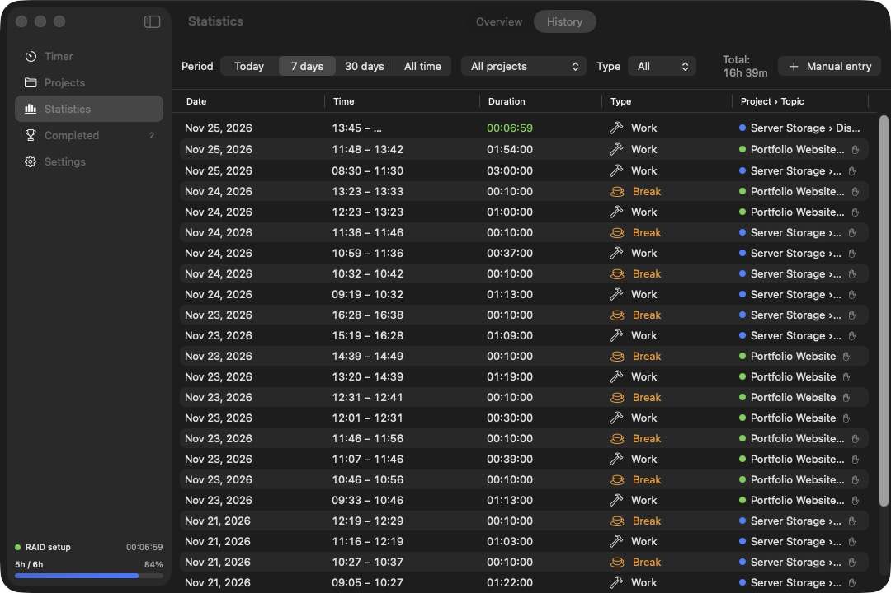

- Filter by period, project and type (work or break). The total for the filter is shown at the top.
- **Edit an entry:** double-click it (or right-click → **Edit…**) to change the topic, type,
  start or end time.
- **Delete:** right-click → **Delete…** or press ⌫.
- **Manual entry:** add work you forgot to track. If the time overlaps an existing entry,
  Athlos warns you, since overlapping time would be counted twice.

## 12. Completed projects

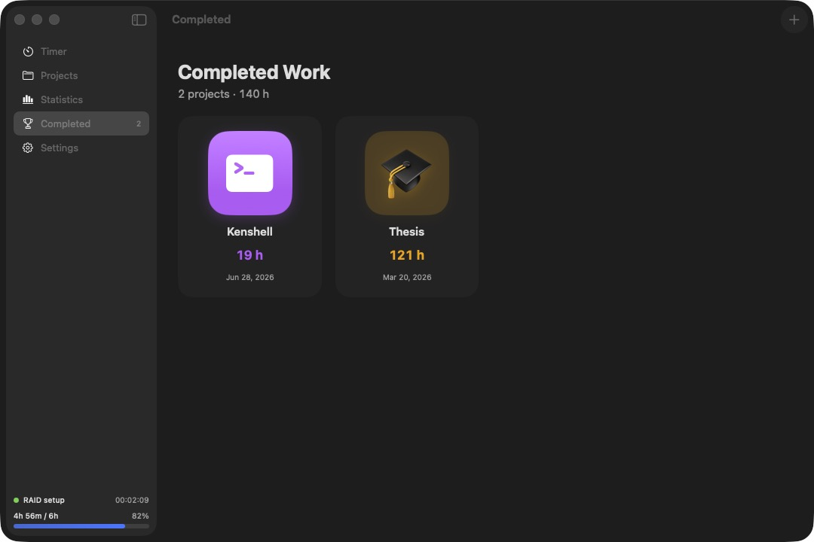

- **Mark a project as completed** from its detail pane. It leaves the project tree and appears
  on the **Completed** page with its logo and total hours.
- Click a card for the details: start and end dates, total days, days worked, time by
  subtopic and notes. **Move back to active** undoes it.
- **Add a project you finished earlier** with **+** (top right): upload the logo (drag and
  drop or **Choose file…**), turn on **Finished**, set the dates and enter the hours you spent
  in **Past time outside the app**. That time is added to the project's total.

## 13. Sleep, lock and idle time

- **Sleep / screen lock** (Settings → Idle and sleep): *Pause the timer* (default) closes the
  work period at the moment the Mac goes to sleep; *Keep counting* doesn't. When you come back,
  press Resume.
- **Idle detection** (off by default): after the number of minutes you set without keyboard or
  mouse activity, Athlos asks *Are you still working?* **Discard idle time** removes that time
  from the session; **Keep the time** keeps it.

## 14. Unfinished sessions

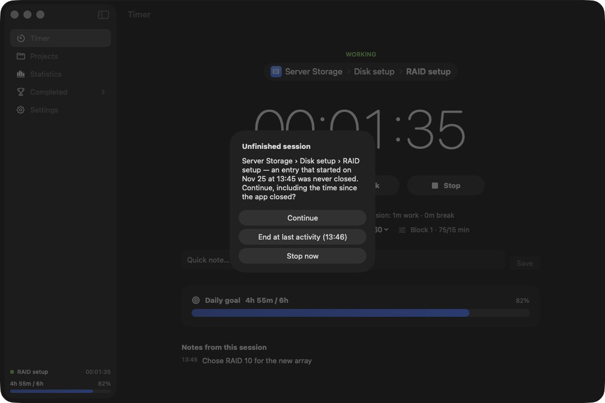

If Athlos quits or crashes while the timer is running, the next launch asks what to do with
that session:

- **Continue:** the session goes on and the time in between counts.
- **End at last activity:** the session ends at the last moment Athlos was running.
- **Stop now:** the session ends now.

## 15. Backup, export and import

In **Settings → Backup**:

- **Daily automatic backup:** once a day Athlos saves a copy in its Backups folder and keeps
  the last 7. **Open backups folder** shows them.
- **Export as JSON…:** saves everything (projects, entries, notes, settings and logos) in one
  file. Use it to move to another Mac or to keep your own backups.
- **Import…:** replaces all current data with a backup file. Athlos makes a safety backup of
  your current data first.

## 16. Language

Athlos is in English by default and includes Turkish. Choose **Settings → Language →
English / Türkçe / System** (*System* follows your Mac's language) and click **Restart now**.
A running timer is kept: after the restart choose **Continue**.

## 17. Keyboard shortcuts

| Shortcut | Action |
|---|---|
| Space | Start / pause (on the Timer page) |
| ⌃⌥Space | Start / pause from anywhere (global) |
| ⌘K | Choose topic |
| ⇧⌘E | Stop session |
| ⇧⌘B | Start break |
| ⌘↩ | Save a quick note |
| ⌘N | New project |
| ⇧⌘N | New subtopic |
| ⌘1 … ⌘5 | Timer, Projects, Statistics, Completed, Settings |
| ⌥⌘W | Show / hide the desktop panel |
| ⌘, | Settings |

## 18. Where your data lives

```
~/Library/Application Support/Athlos/
├── data.json              projects, topics, entries, notes, settings
├── Images/                project logos
├── Backups/               daily backups (last 7)
├── widget-snapshot.json   summary for the widgets
└── WidgetCommands/        short-lived button commands from the widgets
```

Athlos never sends anything over the network.

## 19. Troubleshooting

**The timer shows a different time than I expected after sleep.**
Check **Settings → Idle and sleep**. With *Keep counting*, time while the Mac slept counts as
work.

**No notifications.** Allow them in **System Settings → Notifications → Athlos**, and check
that **Notifications** is on in Athlos Settings.

**⌃⌥Space does nothing.** Another app may already use this shortcut. Turn it off and on again in
Settings, or quit the other app.

**A widget button does nothing.** Athlos has to be running (in the menu bar is enough).

**I deleted something by mistake.** Use **Import…** with a file from **Open backups folder**
(daily backups) or your last export.

## 20. Uninstall

1. Quit Athlos (⌘Q) and remove any widgets from the desktop.
2. Move `/Applications/Athlos.app` to the Trash.
3. To remove your data as well, delete `~/Library/Application Support/Athlos/`
   (export a backup first if you might come back).
